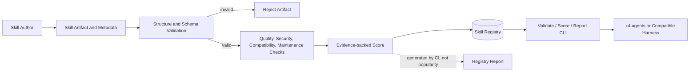
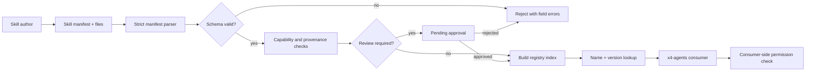

# x4-agent-skills-hub

[](https://github.com/dhe-cruzer69/x4-agent-skills-hub/actions)
[](LICENSE)

**Verified, security-aware registry for AI agent skills.**

Every entry carries quality, security, compatibility, and maintenance scores generated by CI — not marketing counts.

## Why

Agent skill collections are exploding. Most lists do not prove a skill works, is safe, or is compatible with a given harness. This hub treats skills as **artifacts**: validated structure, security metadata, and reproducible scoring.

## Quick start

```bash
git clone https://github.com/dhe-cruzer69/x4-agent-skills-hub.git
cd x4-agent-skills-hub
python -m venv .venv && . .venv/bin/activate
pip install -e ".[dev]"
python -m x4_skills_hub validate
python -m x4_skills_hub score
python -m x4_skills_hub report
```

## Design principles

- **No success claim without evidence** — counts and scores are CI-generated.
- Stars are **popularity**, not quality or safety.
- Separate dimensions: quality, security, compatibility, maintenance, documentation, popularity.
- Apache-2.0 license; read-only CI permissions.

<!-- X4-APEX-DIAGRAM-START:x4-agent-skills-hub -->



<!-- X4-APEX-DIAGRAM-END:x4-agent-skills-hub -->

## Status

Early MVP. Schema and CLI are stable enough for local use; registry growth is intentional and evidence-gated.

## License

Apache-2.0

## APEX Architecture Map

> Status: architecture documentation; implementation and deployment claims require independent verification.



**Evidence note:** Registry persistence, scoring, review, and consumer-side enforcement are shown as design boundaries; verify each is implemented before advertising it as available.

